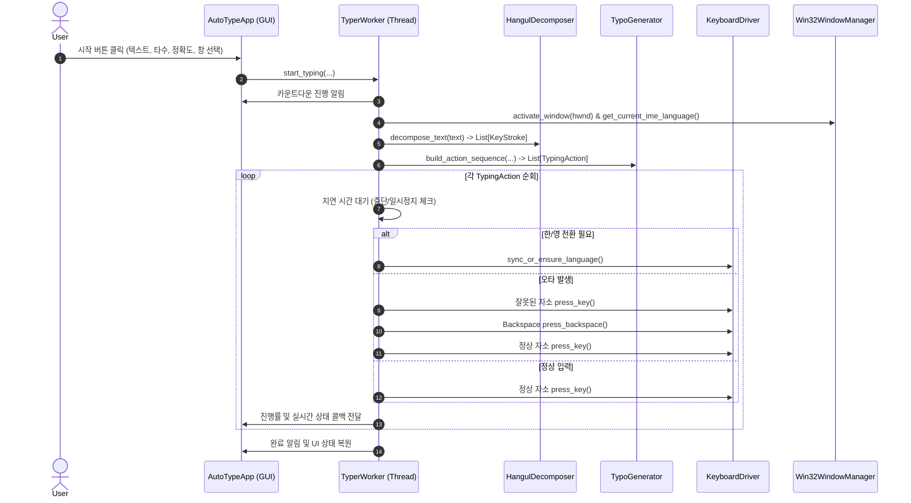

# Auto-Typer 개발자 가이드 (Developer Guide)

본 문서는 **Auto-Typer** 프로젝트의 내부 구조, 모듈 간 상호작용, 핵심 알고리즘, 테스트 방법 및 향후 확장(macOS 지원, 바이너리 패키징 등)을 위한 개발 지침서입니다.

---

## 1. 개발 환경 설정

### 1.1 필수 요구사항
- **Python**: 3.10 이상 (테스트 완료 버전: 3.11.8)
- **운영체제**: Windows 11 권장 (추후 macOS 확장 고려된 구조)

### 1.2 가상환경 구축 및 의존성 설치
프로젝트 루트(`d:\rpa\auto_type`)에서 아래 명령어를 실행합니다.

```powershell
# 가상환경 생성 (.venv)
python -m venv .venv

# 의존성 패키지 설치
.\.venv\Scripts\pip.exe install -r requirements.txt
```

### 1.3 의존성 패키지 목록 (`requirements.txt`)
- `customtkinter`: 모던 테마 데스크톱 GUI 프레임워크
- `pynput`: 저수준 키보드 제어 및 글로벌 핫키 리스너
- `pytest`: 코어 알고리즘 단위 테스트 프레임워크

---

## 2. 프로젝트 디렉토리 구조

```text
d:\rpa\auto_type\
├── .venv/                      # Python 가상환경
├── docs/                       # 프로젝트 문서
│   ├── design.md               # 시스템 아키텍처 및 상세 설계서
│   ├── implementation_plan.md  # 단계별 구현 계획서
│   ├── user_manual.md          # 사용자 설명서
│   └── developer_guide.md      # 개발자 가이드 (본 문서)
├── src/                        # 소스 코드
│   ├── __init__.py
│   ├── main.py                 # 애플리케이션 엔트리 포인트
│   ├── core/                   # OS 독립적 비즈니스 로직
│   │   ├── __init__.py
│   │   ├── models.py           # 데이터 모델 (KeyStroke, TypingAction, LanguageMode 등)
│   │   ├── decomposer.py       # 한글 완성형/자모 2벌식 분해 엔진
│   │   ├── timing_engine.py    # 타수(CPM) 기반 가우시안 랜덤 딜레이 생성기
│   │   ├── typo_generator.py   # 물리 인접 키 기반 오타 생성 및 Backspace 복구 엔진
│   │   └── typer_worker.py     # 백그라운드 작업 스레드, 상태 및 단축키 관리자
│   ├── gui/                    # UI 프레젠테이션 레이어
│   │   ├── __init__.py
│   │   └── app_window.py       # CustomTkinter 메인 윈도우 UI 및 이벤트 바인딩
│   └── os_driver/              # OS 종속 네이티브 레이어
│       ├── __init__.py
│       ├── win32_window.py     # Windows 창 목록 열거, 활성화, IME 상태 감지
│       └── keyboard_driver.py  # 하드웨어 스캔코드 SendInput 및 한/영 제어 드라이버
├── tests/                      # 테스트 스위트
│   └── test_core.py            # 코어 모듈 단위 테스트
├── requirements.txt            # 의존성 정의 파일
└── run.bat                     # 간편 실행 배치 스크립트
```

---

## 3. 핵심 아키텍처 및 데이터 흐름



---

## 4. 주요 모듈별 상세 설명

### 4.1 `src/core/models.py`
- `LanguageMode`: `KO`(한글), `EN`(영문), `NEUTRAL`(공백, 숫자, 일반 기호 등 상태 무관) 정의.
- `KeyStroke`: 단일 물리 키 타건 단위.
  - `key`: QWERTY 키 문자 (예: `'r'`, `'k'`, `' '`, `'\n'`).
  - `shift`: Shift 키 조합 여부 (`True`/`False`).
  - `lang`: 요구되는 언어 모드.
  - `display_char`: UI/로그 표시용 문자.
  - `char_index`: 원본 텍스트에서의 인덱스.
  - `is_typo_target`: 오타 발생 대상 여부.
- `TypingAction`: 드라이버에 전달될 최종 실행 단위.
  - `action_type`: `KEY_PRESS`, `BACKSPACE`, `LANG_SWITCH`, `PAUSE`.
  - `delay_before`: 동작 전 대기 딜레이(초).
  - `hold_duration`: 키를 누르고 있는 시간(초).

### 4.2 `src/core/decomposer.py` (`HangulDecomposer`)
- **유니코드 분해 원리**:
  한글 음절 코드 `0xAC00 ~ 0xD7A3` 범위를 초성(19), 중성(21), 종성(28) 인덱스로 분해합니다.
  $$\text{Code} = (\text{초성} \times 21 + \text{중성}) \times 28 + \text{종성} + \text{0xAC00}$$
- **2벌식 키 시퀀스 매핑**:
  - 쌍자음(`ㄲ`, `ㄸ`, `ㅃ`, `ㅆ`, `ㅉ`): 단자음 키 + `shift=True`.
  - 복합모음(`ㅘ`, `ㅙ`, `ㅚ`, `ㅝ`, `ㅞ`, `ㅟ`, `ㅢ`): 2타의 기본 모음 키로 분해. (예: `ㅘ` $\rightarrow$ `ㅗ` + `ㅏ`)
  - 겹받침(`ㄳ`, `ㄵ`, `ㄶ`, `ㄺ`, `ㄻ`, `ㄼ`, `ㄽ`, `ㄾ`, `ㄿ`, `ㅀ`, `ㅄ`): 2타의 기본 자음 키로 분해. (예: `ㄺ` $\rightarrow$ `ㄹ` + `ㄱ`)

### 4.3 `src/core/timing_engine.py` (`TimingEngine`)
- 분당 타수(CPM) $S \in [S_{\min}, S_{\max}]$를 가우시안 정규분포(평균 중심, $\pm 2\sigma$ 절단)로 샘플링합니다.
- 기본 타건 딜레이:
  $$\Delta t = \frac{60}{S}$$
- 동일 키 연속 입력 시 물리적 특성 반영 가감속($\times 0.85 \sim 1.10$).
- 문장 부호(`.`, `,`, `!`, `?`, `\n`) 직후 인간의 호흡을 모사하는 추가 딜레이($+0.08 \sim 0.22\text{s}$) 부여.

### 4.4 `src/core/typo_generator.py` (`TypoGenerator`)
- **인접 키 사전**: QWERTY 물리 키보드 배열을 기반으로 인접한 상하좌우/대각선 키 목록 유지.
- **IME 조합 안전성 알고리즘**:
  한글 입력 중 무작위 오타가 발생하면 글자 조합이 깨질 수 있습니다. 이를 방지하기 위해:
  1. 한글 모드에서는 자음 위치에는 **인접 자음**만, 모음 위치에는 **인접 모음**만 오타로 선택.
  2. 음절의 첫 자소(초성) 또는 단일 중성 위치에서만 오타를 발생시키고, 즉시 인지 딜레이 후 `Backspace`를 전송하여 조합 상태를 복원.
  3. 이를 통해 오타가 발생해도 **최종 텍스트는 원본과 100% 일치**함을 수학적으로 보장.

### 4.5 `src/os_driver/win32_window.py` (`Win32WindowManager`)
- **창 열거**: `EnumWindows`, `GetWindowTextW`, `GetClassNameW`를 호출하여 현재 활성 창 목록 수집.
- **창 포커스 활성화**: `AttachThreadInput` 기법을 통해 Windows 11의 포커스 도용 방지 정책(Foreground Lock)을 안전하게 우회하여 대상 창을 최상단으로 활성화.
- **실시간 IME 모드 감지**:
  대상 창의 포커스된 컨트롤(`GetGUIThreadInfo`)로부터 기본 IME 윈도우(`ImmGetDefaultIMEWnd`)를 획득하고, `WM_IME_CONTROL` (`IMC_GETCONVERSIONMODE`) 메시지를 보내 현재 한글 모드(`IME_CMODE_NATIVE`)인지 영문 모드인지 100% 정확하게 판별.

### 4.6 `src/os_driver/keyboard_driver.py` (`KeyboardDriver`)
- Windows `SendInput` API를 직접 호출.
- Virtual-Key(`wVk`)뿐만 아니라 `MapVirtualKeyW`를 통한 **하드웨어 스캔코드(`wScan`)**를 함께 전송하여 OS 저수준 입력기(IME)가 키보드 자소 조합을 자연스럽게 수행하도록 구현.
- `sync_or_ensure_language()`: 필요 시에만 `VK_HANGUL`(`0x15`)을 발생시켜 상태 불일치 방지.

### 4.7 `src/core/typer_worker.py` (`TyperWorker`)
- GUI 스레드와 분리된 백그라운드 Worker 스레드 구동.
- `threading.Event` 기반의 일시정지(`pause_event`) 및 정지(`stop_event`) 제어.
- `pynput.keyboard.Listener`를 데몬 스레드로 띄워 전역 `ESC` 및 `F12` 입력 시 즉각적인 비상 정지 보장.

---

## 5. 테스트 실행 및 검증

### 5.1 단위 테스트 실행
프로젝트 루트에서 pytest를 실행합니다.

```powershell
.\.venv\Scripts\python.exe -m pytest -v
```

### 5.2 테스트 케이스 설명 (`tests/test_core.py`)
1. `test_hangul_syllable_decomposition`: '닭', '꽤' 등 복합모음/겹받침 분해 및 Shift 키 매핑 정합성 검증.
2. `test_mixed_korean_english_lang_switch`: 한/영 혼용 문자열에서 불필요한 전환 없이 정확한 시점에 `LANG_SWITCH` 토큰이 생성되는지 검증.
3. `test_typo_and_backspace_recovery_final_consistency`: 정확도 0%(최대 오타) 상태에서도 Backspace 복구 후 최종 결과가 원본 텍스트와 100% 일치하는지 에뮬레이션 검증.
4. `test_cpm_timing_range`: 지정 타수 범위(200~300타) 내에서 지연 시간이 통계적으로 유효한지 검증.

---

## 6. 확장 및 유지보수 가이드

### 6.1 macOS 지원 확장 시 작업 사항
코어 로직(`src/core/`)은 OS 독립적이므로 수정할 필요가 없습니다. 플랫폼 레이어만 추가/수정합니다.
1. `src/platform/keyboard_driver.py`:
   - macOS 환경일 경우 `pynput`의 Quartz CGEvent 구현부를 활용하거나 macOS 한/영 전환 단축키(기본 `Ctrl + Space` 또는 `Caps Lock`) 전송 분기 추가.
2. `src/platform/macos_window.py` (신규 생성):
   - AppleScript(osascript) 또는 `pyobjc-framework-Quartz`를 사용하여 열려 있는 창 목록 열거 및 창 활성화(`tell application ... to activate`) 구현.
3. macOS Accessibility(손쉬운 사용) 권한 체크 안내 로직 추가.

### 6.2 단일 실행 파일(.exe) 패키징
사용자 배포를 위해 PyInstaller를 이용해 `.exe` 파일로 빌드할 수 있습니다.

```powershell
# PyInstaller 설치
.\.venv\Scripts\pip.exe install pyinstaller

# 단일 파일 빌드 (콘솔 창 숨김: --noconsole)
.\.venv\Scripts\pyinstaller.exe --noconfirm --onedir --windowed `
  --name "AutoTyper" `
  --collect-all "customtkinter" `
  src\main.py
```

### 6.3 코딩 규칙 및 가이드라인
- 모든 함수와 클래스 메서드에는 **타입 힌트(Type Hints)**를 작성합니다.
- GUI 스레드와의 통신은 직접 조작하지 않고 `app.after(0, callback)` 패턴을 사용하여 Thread-safe를 유지합니다.
- Win32 API 호출 시 구조체 크기(`sizeof`) 및 64비트 포인터(`ULONG_PTR`) 정렬을 준수합니다.
